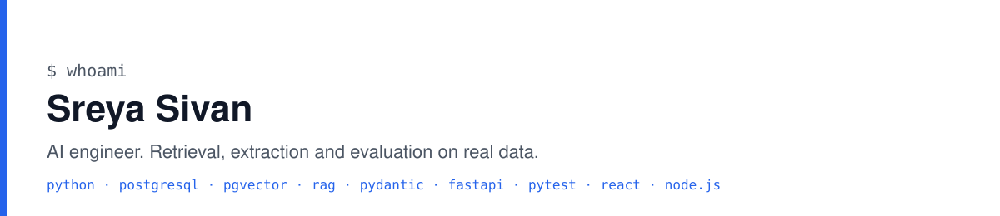

<picture>
  <source media="(prefers-color-scheme: dark)" srcset="banner-dark.svg">
  
</picture>

I'm Sreya Sivan, an AI engineer in Coimbatore, India. I build systems that answer from real documents and measure whether they got it right.

## Now

Studying **Data Science with AI at DataMites** full time since June 2026: Python, machine learning, NLP, databases, big data foundations.

Building **[LabelLens](https://github.com/Sreyasivan/labellens)**: cited question answering and typed extraction over FDA drug labels, with an evaluation harness that runs on every push.

- 2,000 prescription labels from openFDA in Postgres with pgvector and full-text search, hybrid retrieval fused with reciprocal rank fusion.
- A 58-question set, every question verified against the label text before it counts. Retrieval recall@5 57/58; all 8 off-topic questions refused before the model is called.
- Extraction of contraindications, interactions and warnings into typed lists: 221 items, none containing words that are not in the label.
- A local 3B model by default so label text never leaves the machine; OpenAI or Claude by changing environment variables.
- CLI, FastAPI service with generated docs, a plain web page, and CI that fails if recall drops.

The README has the numbers, what they do and do not prove, and the design decisions.

## Before that

**AI intern at [Prayag.ai](https://prayag.ai)**, Jun 2025 to Apr 2026. Built a business development agent in Python, automated data extraction from client emails with the GPT-4 API, and designed RAG chatbot architectures. That code is the company's, so it is not here.

**B.Tech in Information Technology**, Karpagam Institute of Technology, 2022 to 2026 (CGPA 7.83).

## Projects

- **[LabelLens](https://github.com/Sreyasivan/labellens)**: RAG, structured extraction and evals on FDA drug labels. Python, Postgres, pgvector, sentence-transformers, pydantic, FastAPI, pytest, GitHub Actions.
- **[Financial Analytics & Expense Tracker](https://sreyasivan.me/projects/financial-analytics-expense-tracker)**: MERN dashboard with Chart.js spending charts, JWT sign-in and a MongoDB data model.
- **[Notes App](https://sreyasivan.me/projects/notes-app-mern)**: MERN notes with JWT authentication and encrypted storage, so each user sees only their own notes.

## Open to

AI/ML engineer and data science roles in Coimbatore, Bengaluru, Chennai or remote.

## Elsewhere

[sreyasivan.me](https://sreyasivan.me) · [LinkedIn](https://www.linkedin.com/in/sreyasivan) · contact@sreyasivan.me
